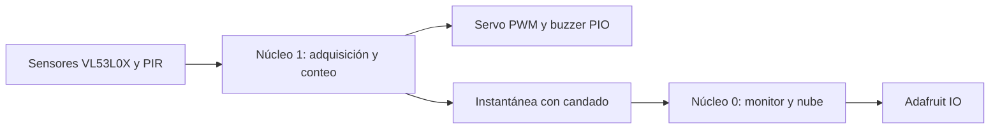

# Documentación técnica

## Arquitectura de un núcleo
El informe y PPT describen seis tareas asyncio: sensores/conteo, PIR, barrera, alarma, monitor y Adafruit IO. PIO genera la onda del buzzer; HTTPS y lecturas I²C siguen siendo síncronas.

## Variante de dos núcleos

MAIN_DOS_NUCLEOS.py permite comparar DOS_NUCLEOS=False y True. El intervalo de pausa entre ciclos es 40 ms, no el intervalo real total.

## Reto de arquitectura
PIO: 32 ciclos altos y 32 bajos a 64000 ciclos/s = 1000 Hz teóricos. No hay comparación medida antes/después de PIO.
Dos núcleos: el código registra ciclos, máximo intervalo entre inicios, máxima duración de ciclo y fallos de sensor. El README recibido menciona 124 ms, 83 ms y 0 fallos en modo dual; no hay captura específica ni línea base en el ZIP. No afirmar mejora. Ensayar el mismo archivo con ambos modos, bajo las mismas condiciones y registrar los datos reales en la [plantilla de pruebas](resultados_1_vs_2_nucleos.csv).

## Evidencia y resultados
| Prueba | Resultado | Alcance |
|---|---|---|
| Dirección | 47/50 (94 %) | Reportado en paper y PPT; sin registro individual |
| Capacidad | 3, 5 y 7 | Respuesta correcta reportada |
| Nube | HTTP 200 y dashboard 5/5 | Capturas de la versión de un núcleo |
| Presencia | 80–120 ms | Teórico |
| PIO / dual | Sin comparación controlada | Pendiente |
| Reconexión y calibración 100 mm | Pendiente de documentar | No sustituir por calibración de 87 mm |

## Revisión de entregables
PDF recibido tiene 7 páginas (guía: 4–6), con referencias en la última. PPT contiene 12 diapositivas. Ambos describen la versión de un núcleo; armonizarlos con el reto final acordado. Declarar uso de IA en paper y verificar códigos universitarios: README recibido y paper discrepan. Video original: 133,77 s, límite 120 s. No inventar resultados.
