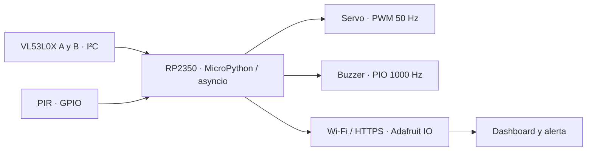

# Documentación técnica

## Arquitectura

Las seis tareas de la versión integrada son sensores/conteo, PIR, barrera, alarma, monitor y Adafruit IO. Se ejecutan cooperativamente en un núcleo, no en dos. La pausa de adquisición es de 40 ms más el tiempo real de lecturas y otras tareas.

## Reto PIO
La máquina de estados del buzzer genera 32 ciclos altos y 32 bajos a 64 000 ciclos/s: 1000 Hz teóricos. El servo conserva PWM de 50 Hz. PIO delega la generación de flancos; 2000 cambios/s serían necesarios para una onda cuadrada equivalente por software. La mejora real de CPU/latencia no ha sido medida. La guía requiere comparación antes/después (10 puntos de 60).

Propuesta de ensayo pendiente: comparar dos versiones con la misma carga, configuración y tono, una con generación por CPU y otra con PIO; registrar intervalos de adquisición y dispersión durante un aviso, con varias repeticiones. No confundir el programa local de buzzer digital con un ensayo controlado de onda de 1000 Hz.

## Resultados
| Prueba | Resultado reportado | Límite de evidencia |
|---|---|---|
| Reconocimiento de dirección | 47/50 correctos (94 %) | Sin desglose por sentido ni registro individual |
| Límites de ocupación | Respuesta correcta con 3, 5 y 7 | Sin número de repeticiones |
| Adafruit IO | HTTP 200 en ambos feeds; dashboard 5/5 y estado 1 | Capturas del informe pp. 4–5 |
| Presencia | 80–120 ms teóricos | No medidos |
| Calibración anterior | 87 mm: fondo A 114 mm, B 135 mm | No equivale a la calibración integrada de 100 mm |
| PIO antes/después | Pendiente | No se dispone de medición |
| Reconexión Wi-Fi y consumo | Pendientes | No se dispone de ensayo o instrumento |

Fuentes: informe pp. 2–6, presentación diapositivas 6–10, código integrado y guía pp. 3–8. Deben incorporarse los archivos originales del informe y las diapositivas. 
