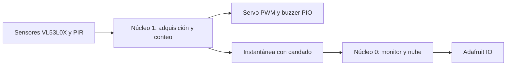

# Documentación técnica

## Arquitectura de un núcleo
El informe y PPT describen seis tareas asyncio: sensores/conteo, PIR, barrera, alarma, monitor y Adafruit IO. PIO genera la onda del buzzer; HTTPS y lecturas I²C siguen siendo síncronas.

## Variante de dos núcleos

MAIN_DOS_NUCLEOS.py permite comparar DOS_NUCLEOS=False y True. El intervalo de pausa entre ciclos es 40 ms, no el intervalo real total.

## Reto de arquitectura
PIO: 32 ciclos altos y 32 bajos a 64000 ciclos/s = 1000 Hz teóricos. No hay comparación medida antes/después de PIO.
Dos núcleos: El 26/11/2026 se recibieron capturas de Thonny del mismo firmware seleccionable con `DOS_NUCLEOS=False` y `True`. En reposo (aforo 0, PIR 0), con Wi-Fi conectado y HTTP 200, se observaron máximos acumulados de 1655 ms (un núcleo) y 121 ms (dos núcleos), una reducción del 92,69 %; la duración máxima del ciclo fue 76 y 81 ms respectivamente, con 0 fallos de lectura en ambos registros. No se conoce la duración exacta de los ensayos ni hay repeticiones o cruces comparables documentados; los conteos de ciclos no se usan para estimar rendimiento. El resultado es preliminar y no equivale a una medición de latencia extremo a extremo. Consultar [CSV](resultados_1_vs_2_nucleos.csv), [análisis experimental](RESULTADOS_EXPERIMENTALES.md) y [gráfico](comparacion_nucleos.svg).

## Evidencia y resultados
| Prueba | Resultado | Alcance |
|---|---|---|
| Dirección | 47/50 (94 %) | Reportado en paper y PPT; sin registro individual |
| Capacidad | 3, 5 y 7 | Respuesta correcta reportada |
| Nube | HTTP 200 y dashboard 5/5 | Capturas de la versión de un núcleo |
| Presencia | 80–120 ms | Teórico |
| Dual | 1655 → 121 ms (−92,69 %) | Máximo intervalo entre ciclos, en reposo; comparación preliminar |
| Calibración 100 mm | A: 103 mm; B: 129 mm original, 99 mm ajustado | Umbrales A 83/94, B 79/90 mm; advertencia de orientación B |
| Reconexión | Implementada | Pérdida y recuperación no evidenciadas |

## Revisión de entregables
Se prepararon versiones revisadas del paper (6 páginas con referencias y declaración de IA) y PPT (12 diapositivas), distinguiendo resultados históricos de un núcleo y variante seleccionable dual. Se omiten códigos universitarios hasta confirmación. Video editado: aproximadamente 117 s, aceleración del 14 %; comprobar claridad. La presencia de los adjuntos corregidos se comprobó en main; queda pendiente su validación por el equipo. No se han generado mediciones ficticias. El análisis experimental actualiza los resultados de los documentos previos; los binarios del paper y PPT requieren carga de las nuevas versiones.
