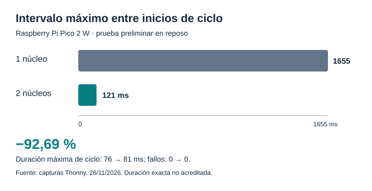

# Resultados experimentales — 26/11/2026

## Método y alcance
El 26/11/2026 se recibieron capturas de Thonny del mismo firmware seleccionable con `DOS_NUCLEOS=False` y `True`. En reposo (aforo 0, PIR 0), con Wi-Fi conectado y HTTP 200, se observaron máximos acumulados de 1655 ms (un núcleo) y 121 ms (dos núcleos), una reducción del 92,69 %; la duración máxima del ciclo fue 76 y 81 ms respectivamente, con 0 fallos de lectura en ambos registros. No se conoce la duración exacta de los ensayos ni hay repeticiones o cruces comparables documentados; los conteos de ciclos no se usan para estimar rendimiento. El resultado es preliminar y no equivale a una medición de latencia extremo a extremo.

| Métrica | Un núcleo | Dos núcleos |
|---|---:|---:|
| Intervalo máximo entre inicios de ciclo (ms) | 1655 | 121 |
| Duración máxima del ciclo (ms) | 76 | 81 |
| Ciclos con fallos de lectura | 0 | 0 |
| Último contador visible (no comparable como tasa) | 269 | 715 |

Reducción = (1655 − 121) / 1655 × 100 = 92,69 %. El intervalo máximo observado en modo de un núcleo fue 13,68 veces el de dos núcleos. La duración máxima de ciclo aumentó 5 ms (+6,58 %); la ventaja observada es continuidad de adquisición, no aceleración de cada ciclo. HTTPS síncrono puede explicar la pausa en modo de un núcleo; no se instrumentó causalidad individual.

## Calibración al arranque (ambos modos)
| Parámetro | A | B |
|---|---:|---:|
| Dirección I2C | 0x30 | 0x31 |
| Fondo original (mm) | 103 | 129 |
| Fondo ajustado (mm) | 103 | 99 |
| Umbral de detección (mm) | 83 | 79 |
| Umbral de liberación (mm) | 94 | 90 |

El sensor B tiene ajuste de −30 mm y advertencia por desviación superior a 25 mm del fondo nominal de 100 mm. No se ha demostrado corrección de orientación. La nube muestra HTTP 200; no se evidencia interrupción y reconexión.

## Trazabilidad de las cinco capturas recibidas
- 1:10:32 p. m.: arranque dual, calibración, Wi-Fi y HTTP 200.
- 1:10:53 p. m.: dual, ciclos 35–261, 121 ms, 81 ms, 0 fallos.
- 1:11:17 p. m.: dual, ciclos 487–715, 121 ms, 81 ms, 0 fallos; ambos feeds HTTP 200.
- 1:12:11 p. m.: arranque un núcleo, misma calibración, Wi-Fi y HTTP 200.
- 1:12:52 p. m.: un núcleo, ciclos 41–269, 1655 ms, 76 ms, 0 fallos.

Las capturas originales fueron facilitadas por el equipo; esta transcripción no las sustituye. La carga de los JPEG y de los binarios actualizados debe verificarse por separado. Las 47/50 direcciones correctas (94 %) del informe previo son una prueba histórica distinta, no un resultado de este ensayo.
