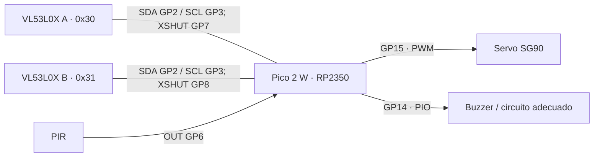

# Hardware y conexiones

Fuente: tabla 1 del informe (p. 2) y MAIN_UN_NUCLEO.py. Mapa lógico documentado; no sustituye la verificación física por el equipo y el docente.

| Componente | Señal | GPIO | Pin físico |
|---|---|---|---|
| 2 × VL53L0X | SDA compartido | GP2 | 4 |
| 2 × VL53L0X | SCL compartido | GP3 | 5 |
| VL53L0X A | XSHUT | GP7 | 10 |
| VL53L0X B | XSHUT | GP8 | 11 |
| PIR | OUT | GP6 | 9 |
| SG90 | PWM 50 Hz | GP15 | 20 |
| Buzzer | PIO 1000 Hz | GP14 | 19 |

## Diagrama lógico de conexiones

## Alimentación documentada
El informe indica ToF en 3V3 OUT (pin 36) y GND (38), servo con fuente externa de 5 V y masa común, y alimentación del PIR según su módulo. El GPIO de la Pico es de 3,3 V; quedan por confirmar el modelo de PIR, compatibilidad de niveles y circuito/corriente del buzzer con el docente. El esquema lógico no representa un circuito de potencia verificado.

## Calibración
13 muestras por sensor, mínimo 8 válidas; se usa la mediana. Márgenes de detección/liberación de 20/9 mm y tres confirmaciones. La versión integrada tiene ancho nominal de 100 mm y ajuste B de −30 mm. Registrar fondos reales del montaje actual; las capturas de 87 mm corresponden a una versión anterior.
